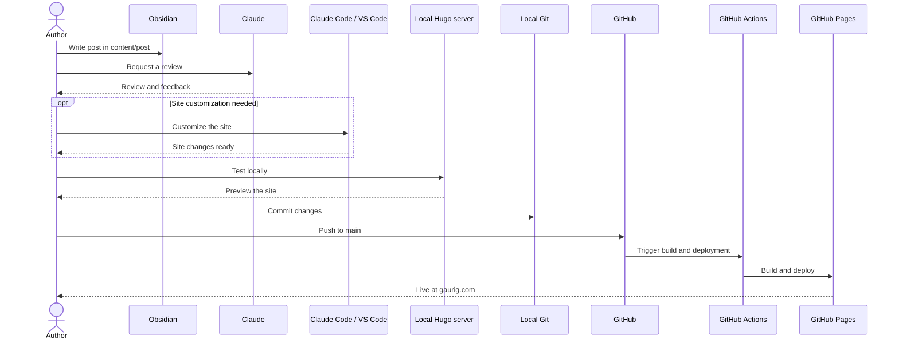

+++
date = '2026-09-22T19:44:01-04:00'
draft = false
title = 'Hugo Blog Setup'
image = 'cover.png'
categories = ['How-to']
tags = ['Tech']
+++

I am no frontend wizard, yet I was able to set up a fully customizable website for my blog largely thanks to Hugo. 
*************************************************************************
## Hugo: A Static Site Generator

Hugo enables you to write your content in Markdown files. It then works its Go magic to turn those Markdown files into HTML and renders this HTML through your chosen theme's templates at build time. Combined with the theme's CSS and JavaScript, the output is a folder of static files easy for any web server to host. Full flexibility, full ownership, none of the frontend hassle. 

The following is a walkthrough of my end-to-end setup and blogging flow. 
*************************************************************************
## The Setup

### Toolkit
| Job | Tool | What it does |
|---|---|---|
| Site generator | Hugo (Extended) | Turns Markdown into static HTML |
| Theme | Stack | Layout and styling |
| Version control | Git | Tracks every change to the site |
| Code hosting | GitHub | Stores the repo |
| Build and deploy | GitHub Actions | Builds the site on every push |
| Hosting | GitHub Pages | Serves the built files |
| Domain | Namecheap | Points gaurig.com at the site |

### Installing Hugo
**The first step** was to install Hugo and make a new project. I then picked a theme from [Hugo's theme repository](https://themes.gohugo.io/) and set it up as a submodule within my project's `themes/` folder. It could also be set up as a Go module, but for that I'd need to install Go on my machine. I chose the Stack theme because it is one of Hugo's most popular themes and is well maintained, which makes it a good bet for my blog's longevity.

> [!TIP] What is a Git submodule?
> A Git submodule embeds one Git repository inside another. Although the theme's files are physically present on your filesystem, committing to the parent repository does not put those individual files into the parent's commit. Instead, Git stores a link to the theme's repository and the exact commit you are using. That keeps the theme separate from your own code, and you choose when to update it.

> [!NOTE]
> If you are a WSL user like me, you may find that your distro's (in my case, Ubuntu) package repository carries an older version of Hugo, so `sudo apt install hugo` will not be sufficient. Instead, download the latest extended release from [Hugo's GitHub releases page](https://github.com/gohugoio/hugo/releases), unpack it, move the `hugo` binary into `~/.local/bin`, and add that folder to your `PATH`.

> [!WARNING]
> Always make sure your Hugo version and your theme version are compatible. Themes declare the minimum Hugo version they need (in Stack's case, in its `theme.toml`), and a mismatch can cause build errors or missing features.

### Populating .gitignore
**The second step** was to set up a base `.gitignore`, which tells Git which files to leave out of version control. Mine is short, and everything in it is either generated by Hugo or specific to my machine:

| Entry                               | Why it is ignored                                                                                                                                                                            |
| ----------------------------------- | -------------------------------------------------------------------------------------------------------------------------------------------------------------------------------------------- |
| `/public/`                          | The built site that the `hugo` command generates. GitHub Actions builds a fresh copy on every push, so committing it would be redundant.                                                     |
| `/.hugo_build.lock`                 | An empty lock file Hugo creates while building to stop two builds from running at once. It means nothing on another machine.                                                                 |
| `/resources/_gen/`                  | Hugo's cache of processed assets, such as compiled SCSS and resized images. Hugo regenerates it whenever it is missing.                                                                      |
| `/content/.obsidian/workspace.json` | My `content/` folder is also an Obsidian vault, and this file records which notes and panes I have open. It changes constantly and only matters locally. Committing it would only add noise. |

### Build and Deployment
**The final step** was deployment. Rather than building the site by hand and uploading it, I let a GitHub Actions workflow do it: every push to `main` builds the site and publishes it to GitHub Pages. The workflow is a YAML file at `.github/workflows/hugo.yaml` and it has two jobs. The `build` job runs on a fresh Ubuntu machine:

| Step            | What it does                                                                                       |
| --------------- | -------------------------------------------------------------------------------------------------- |
| Checkout        | Pulls down the repo, including the theme submodule (`submodules: recursive`).                      |
| Setup Hugo      | Installs the extended version of Hugo, which Stack needs to compile its SCSS.                      |
| Build           | Runs `hugo --gc --minify`, which clears unused cache files and minifies the output into `public/`. |
| Upload artifact | Packages `public/` so the next job can use it.                                                     |

> [!TIP]
> My workflow pins Hugo to a specific version (`0.166.0`, the same one I use locally) instead of installing the latest release on every run. That way a new Hugo release can't unexpectedly clash with the theme or break the build. When I want to upgrade, I update the version in `hugo.yaml` and on my own machine at the same time.

The `deploy` job waits for `build` to succeed, then publishes that package to GitHub Pages using a fresh machine. For this to work, the repository's Pages source in GitHub (under Settings, then Pages) has to be set to GitHub Actions. 

To serve the site from my own domain, I entered it in the Pages settings, enabled HTTPS, and added DNS records in Namecheap that point to GitHub's IPs. GitHub Pages now serves my website at gaurig.com.

*************************************************************************
## The Flow 

### Toolkit
| Job                   | Tool                   | What it does                                                                                                  |
| --------------------- | ---------------------- | ------------------------------------------------------------------------------------------------------------- |
| Writing               | Obsidian               | Markdown editor. My `content/` folder is an Obsidian vault, so I write posts in the same files Hugo publishes |
| Research and drafting | Claude (desktop app)   | Helps me research topics and draft and edit posts, using a Claude project set up for this blog                |
| Customization         | Claude Code in VS Code | AI coding assistant that works directly in the repository for code-level changes to the site                  |

### Obsidian
Now comes the fun part: creating content. My editing workspace for posts is Obsidian. It is yet another Markdown-based tool, which is exactly why it pairs so well with Hugo. Besides, VS Code is not the nicest place to edit Markdown. I turned my `content/` folder into an Obsidian vault by opening it in Obsidian, which creates a `.obsidian/` folder inside it for the app's settings. Now I just edit away in Obsidian's nice live-preview editor interface. 

> [!WARNING]
> Obsidian and Hugo do not speak exactly the same Markdown. Both understand standard Markdown, including GitHub-style tables and task lists. But Obsidian adds its own syntax on top, such as `[[wikilinks]]`, `==highlights==` and `%%comments%%`, which Hugo does not recognize and prints as literal text. The reverse is also true: Hugo has shortcodes, such as `` for embedding a video, that only Hugo knows how to turn into HTML. Obsidian does not recognize them and shows them as plain text, but they can stay in a post, because Hugo replaces them with the embedded video when it builds the site. I will have a tip to tackle these differences later in the post. 

### Claude Code and VS Code
This bit is pretty straightforward. I do all customization work in VS Code with Claude Code as my harness. In claude.md, I specify instructions such that Claude Code knows not to touch my `themes/hugo-theme-stack/` folder as it is a submodule, and instead use Hugo's project-level overrides. These work because Hugo checks my project's own folders, such as `layouts/`, `assets/` and `static/`, before it looks in the theme. If I add a file at the same path as one in the theme, Hugo uses mine instead, so I can change how the site looks and behaves without ever editing the theme itself. 

### Claude, MCP and a project
For research, drafting and editing, I use the Claude desktop app with two things set up.

The first is a connection to my Hugo project through MCP (Model Context Protocol), an open standard that lets Claude reach tools and data outside the chat. I installed the Filesystem extension (MCP under the hood) and gave it access to my Hugo project folder and nothing else. Claude can now read my Hugo project, its posts and edit my content directly instead of me copying text back and forth. 

The second is a Claude project dedicated to this blog. Its instructions tell Claude that my local Hugo project is the source of truth, to inspect the installed Stack theme before suggesting any theme-specific feature, and to leave the theme folder alone. That way it works with the site I actually have instead of guessing from general knowledge.

> [!TIP]
> The Obsidian and Hugo Markdown differences above are easy to avoid if my writing assistant knows about them. In my Claude project's instructions, I tell Claude to use only Hugo-compatible Markdown and to avoid Obsidian-only syntax such as wikilinks, so anything it drafts or edits for me publishes correctly. 

### Blogging Pipeline 
This is the path a post takes from a blank page to the live site:

Customization only comes into play when a post needs a change to the site itself, such as a layout override. Everything after the push happens automatically: GitHub Actions builds the site and GitHub Pages serves it.

You can see all the details, including the workflow, `.gitignore` and setup script, in my [public repository on GitHub](https://github.com/guptg/guptg.github.io). 
